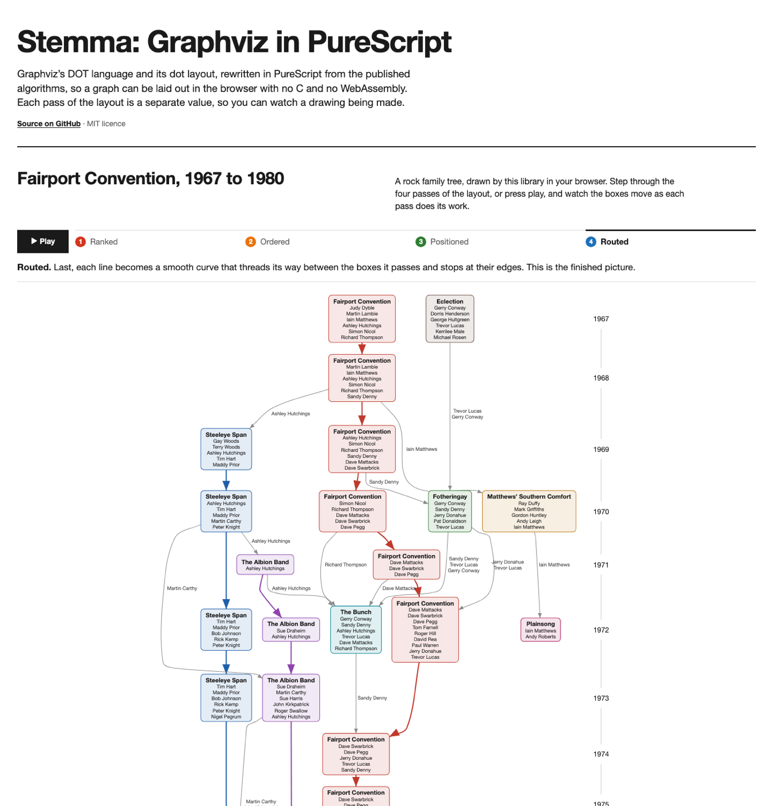

# Stemma: Graphviz in PureScript

Graphviz's DOT language and its `dot` layout, written in PureScript from the
published algorithms. A graph can be laid out wherever PureScript runs, a
browser included, with no C and no WebAssembly, and each pass of the layout
is a value you can take hold of.



**Demo:** <https://afcondon.github.io/purescript-stemma/>. A family tree
of Fairport Convention and the bands around it, drawn in your browser, with
a control that steps through the four passes of the layout; and below it an
editor that draws DOT as you type, beside Graphviz's own drawing of the
same file.

## Why

- **A drop-in for the browser.** The usual way to get Graphviz on a web
  page is a WebAssembly build of the C. This is a few hundred kilobytes of
  JavaScript compiled from PureScript, and nothing else.
- **The passes are separate.** Graphviz gives you a finished picture. Here
  ranking, ordering, placing and routing are functions with plain data
  between them, so a program can stop after any of them, show it, or put
  something of its own in a pass's place. That is what the demo's
  step-through shows, and it is the point of the project: a layered layout
  whose stages can be combined with other layouts, a force simulation among
  them.
- **Held to Graphviz.** The installed Graphviz is the judge. Each stage is
  compared with what Graphviz itself does on a corpus of nearly 900 DOT
  files, and a stage is not claimed until that comparison says so. The
  figures are in the table below.

## Using it

The package is `stemma`, and its modules are `Stemma.*`. (A stemma is a
family tree, of people or of manuscripts. The registry already has a
`graphviz` package, which is a different thing by another author.)
It is not in the PureScript registry yet. Until it is, add it to a spago
workspace from git:

```yaml
workspace:
  extraPackages:
    stemma:
      git: https://github.com/afcondon/purescript-stemma.git
      ref: main
      subdir: core
```

```purescript
import Stemma.Layout (layout)
import Stemma.Svg (render)

svg :: String -> Either String String
svg dot = render <$> layout dot
```

`layout` takes DOT text and returns a `Drawing`: boxes for the nodes,
curves for the edges with the place of each label, boxes for the clusters,
all in points. `Stemma.Svg.render` turns that into plain SVG text; a
caller with its own renderer uses the `Drawing` itself, as the demo page
does.

- `layoutWith` takes the spacing and a function that measures text. How
  wide a label is depends on the font and on what draws it, so the caller
  says; the built-in guess is rough. In a browser, pass one that asks a
  canvas (`site/src/Site/Measure.purs` is such a function).
- `drawAt` gives the drawing as it stands after one pass: `Ranked`,
  `Ordered`, `Positioned` or `Routed`.
- `Stemma.Dot.Parser.parse` and `Stemma.Graph.fromDot` give the graph a
  DOT file describes, with no layout, for a program that wants to read DOT
  and do something else with it. See "The graph a caller gets" below.
- `Stemma.Layout.Rank` and `Stemma.Layout.Order` are the first two
  passes by themselves.

## What it does, and what it does not

It reads the whole DOT language as Graphviz reads it, and lays out with
`dot`'s method: ranks by network simplex (with `rank=same` and its
relatives, `minlen`, `weight`, `constraint`), cycles broken as dot breaks
them, each rank ordered to leave few crossings, clusters kept together and
boxed, coordinates by network simplex again, and edges drawn as curves
that end on the node outlines. It honours `rankdir`, `nodesep`, `ranksep`,
`size`, `fontsize`, `width` and `height`, edge labels, loops, several edges
between the same two nodes, and record and HTML-like labels as far as
sizing them and showing their lines of text.

It does not do the other layouts (`neato`, `fdp`, `circo`, `twopi`), most
of the node shapes (each is drawn as the nearest of five outlines), ports
on edge ends, tables inside HTML labels, `splines=ortho`, or `concentrate`.
A cluster with a `label` keeps a strip along its top for it, so nothing
in the cluster is under its name; the cluster is not made wider for a name
longer than it is. An edge may cross the box of a cluster it is not in. It is not fast on
large graphs: a few dozen nodes draw as you type, a few hundred take
seconds. `known-differences/README.md` lists every standing difference
from Graphviz, each with its reason.

## Where it stands

| Stage | State | Held to |
|---|---|---|
| Reading DOT: lexer, parser, and what the file means | done | 890 of 890 corpus files read exactly as Graphviz 14.1.2 reads them (885 the same, 5 rejected by both) |
| Which subgraphs are clusters | done | the same as dot draws, on 884 of 884 files (1,957 subgraphs) |
| Ranking (which layer each node is on), with `rank=same` and its relatives and with clusters | done, bar the cases below | 883 of 883 rankings proved optimal at every level; dot's own ranking equals the optimum on 879 and is worse on 4 |
| Turning cycles round before ranking | done | the same edges as dot on 328 of 329 graphs with cycles |
| Ordering within ranks, with clusters kept together and in one order, and same-rank edges left to right | done; slow on large graphs | of 884 graphs, the same number of crossings as dot on 709, fewer on 92, more on 83; 12,346 crossings in all against dot's 12,855 |
| Coordinates | by network simplex: nodes, bends, cluster sides, room for labels and loops | 883 of 883 drawings keep every rule of `bin/check-geometry.py`; area 1.12 times dot's at the median |
| Edge routing | curves pulled tight between the nodes they pass, ending on the node outlines; cluster boxes not kept clear | of 16,598 edges, 4 pass through a node that is not theirs (dot: 1); length 1.10 times dot's at the median |

`bin/check.py` and `bin/check-geometry.py` print the current figures; this
table is only as fresh as its last edit (2026-11-21).

Speed: a graph of a few dozen nodes lays out as you type. One of 200
nodes and 300 edges takes about five seconds in Node, most of it in the
ordering; that size is for a batch run and not for a live page.

## Reading DOT

"What the file means" is more than parsing. A node's attributes depend on
which defaults were in force where and when it was first mentioned, a named
subgraph mentioned twice is one subgraph, and in a `strict` graph whether a
second edge between two nodes is merged, ignored or kept depends on its key
and on which subgraph the statement is in. `core/src/Stemma/Graph.purs`
states the rules; they were found by experiment against Graphviz, and some
of them are not what its documentation says.

The comparison covers the graph's attributes, every node and edge with its
attributes, and every subgraph with its nesting and its members.

Text is plain or an HTML string (`<...>`), and the two are kept apart as
Graphviz keeps them: `<b>` and `b` are different nodes, and an attribute
value remembers which it was. The comparison includes that.

## The graph a caller gets

`Stemma.Graph` is what the layout passes work on, and what another
library would use:

- `Graph` is opaque and made only by `fromDot`, so every edge joins two of
  its nodes and every member of a subgraph is in the graph.
- Node names, edge numbers and subgraph numbers are their own types
  (`NodeName`, `EdgeId`, `SubgraphId`).
- Every edge end has a place for a port (`tailPort`, `headPort`): a name
  the node defines, a compass point, or both. Nothing uses them yet; they
  are there so that ordering and coordinates can.
- Subgraphs form a tree (`parent`), each says whether it is a cluster, and
  `clusters` and `enclosingCluster` give the clusters and their nesting.
- Attributes stay text, since a file may set anything, and
  `Stemma.Attributes` is the one place that reads a value as a number, a
  boolean, a port or a rank kind.

Known differences from Graphviz are in `known-differences/`, each with its
reason.

- `corpus/graphviz/`: the 60 example graphs that ship with Graphviz. They
  are not kept here; `bin/fetch-examples.py` copies them from the Graphviz
  installed on the machine.
- `corpus/semantics/`: about 60 small files, one per rule.
- `corpus/generated/`: 400 random files that lean on the order-dependent
  parts of the language (`bin/generate.py`, seeded).
- `corpus/layout/`: 300 random graphs with plain attributes, for the layout
  passes (`bin/generate-layout.py`, seeded).
- `corpus/ranking/`: the cases where dot's ranking is not optimal.
- `corpus/ranksets/`, `corpus/clusters/`, `corpus/cycles/`,
  `corpus/ordering/`: small files, one per rule.

A further 9,000 random files from three other seeds were compared on
2026-11-20. They found the HTML-string rule and the file in
`known-differences/`, and otherwise agreed; they are not kept.

## Ranking

Ranking is an optimisation: put every edge's head at least `minlen` ranks
below its tail, at the least total of weight times length. The core solves
it with the network simplex of Gansner, Koutsofios, North and Vo (1993), in
`core/src/Stemma/Layout/NetworkSimplex.purs`, and returns with each answer
the spanning tree that proves it optimal. `bin/check.py` checks that proof
itself, in a few lines that use nothing of the core but its answer.

dot's ranking is then costed against that optimum. To compare like with
like, the core is given the cycles as dot broke them. `dot -Gphase=1` stops
dot after ranking and reports each node's rank, so no ranks have to be
guessed from coordinates.

**dot is not always optimal.** This was not expected. On
`digraph { b -> c [weight=30]; a -> b; a -> c [minlen=3] }` dot 14.1.2 puts
`b` on rank 1, stretching the weight-30 edge over two ranks (total 64, where
35 is possible). Declare `a` before `b` and it finds the optimum. The cases
are in `corpus/ranking/`. Why dot stops short is not known here; its source
has not been read. So "the same as dot" and "as good as possible" are two
different targets for this pass, and at present the core hits the second.

The solver is the plain one: it recomputes every cut value from its
definition each round, which is easy to see is right and slow on a large
graph. The largest graphs in the corpus have 200 nodes.

### Rank sets and clusters

A subgraph with `rank=same` is ranked as one thing; `min`, `max`, `source`
and `sink` pin a set to the top or bottom. A cluster is ranked on its own
first and then moves as a rigid block, and an edge that crosses a cluster's
border is a preference and not a requirement: it may fail, at ten times its
weight per rank. So the ranking is a tree of problems, one per level (the
graph, each cluster, each cluster within a cluster), and each level's answer
carries its own proof. `core/src/Stemma/Layout/Rank.purs` states the
rules; like the reading rules they were found by experiment against `dot`.

For each level the judge also checks that dot's ranking fits the model: the
nodes the core moves together are together in dot's ranking, and dot's
ranks satisfy every requirement the core derived. On the corpus they always
do, which is the evidence that the model is dot's.

Not yet handled, and reported as NOT RUN: a `rank=same` subgraph that
reaches into a cluster beside it (1 corpus file), `newrank`, and graphs
that limit the solver (`nslimit`). A graph that asks for one node to be on
both the top and the bottom rank makes dot itself fail.

## Turning cycles round

A ranking needs every edge to point down, so in each cycle some edge has to
be turned round, and it is then drawn pointing up the page. Any choice gives
a valid ranking; the choice shows in the picture. This follows dot's:
`core/src/Stemma/Layout/Acyclic.purs` walks the graph depth first as dot
does, and matching it took three details found by experiment: where the walk
starts, that a node's edges are taken in the order of the nodes they lead
to, and that when an edge is turned round the last edge in its node's list
moves into the gap. The one corpus graph still different is a cluster that
also sets `rank=same`.

## Ordering within ranks

Long edges are cut into chains with a bend on every rank they pass, and
then the nodes and bends of each rank are ordered to leave few crossings:
`core/src/Stemma/Layout/Order.purs`, the median-and-swap search of the
1993 paper, run on dot's schedule.

Two things hold in every order: the nodes of a cluster that share a rank
stand side by side (a rank is treated as a tree, and whole clusters are
moved and swapped as single things), and an edge between two nodes on one
rank has its tail on the left. The second cannot always be had: such edges
can go round in a circle, or ask for a node to stand between two nodes of
one cluster. Then one request is given up, and what remains is consistent
by construction.

A third thing holds across ranks: two clusters that stand side by side
keep the same order in every rank they share, since otherwise no box could
be drawn round each. When the first ordering leaves two clusters both ways
round, the clusters are put in one line and the ranks are ordered again
with that line kept. An edge along a rank between two such clusters then
runs right to left if the line says so; dot gives way in the same place.
The judge checks all of this on every graph: 884 of 884.

An edge marked `constraint=false` has no say in the order and its crossings
are not counted, which is dot's rule too.

Nothing is optimal here, for dot or for this, so the two are compared by
result. Each orders the same ranking (dot's, from `dot -Gphase=2`), and the
crossings are counted. dot says how many it left (`dot -v`); to be sure the
two counts are of the same thing, the core's counter is run on dot's own
order wherever that order is fully known (no long edges), and must give
dot's number. It does on 277 of 277.

dot's own order, judged by the same two rules, never splits a cluster. It
does put the head of a same-rank edge on the left on some graphs
(`known-differences/` has a five-edge example).

It is slow on the largest corpus graphs (200 nodes): the crossing count and
the swaps are written the plain way and are quadratic.

Not done: an edge that passes a cluster on one side on one rank and the
other side on the next is not discouraged beyond its ordinary crossings, so
it can end up drawn across the cluster's box. dot discourages it heavily.

## How the comparison is made

```bash
spago build
bin/fetch-examples.py   # once: Graphviz's own examples, and its answers to them
bin/check.py            # reading, clusters, ranking, ordering: about four minutes
bin/check.py --record   # re-ask the installed Graphviz first
bin/check-geometry.py   # coordinates and edges: about twenty minutes
bin/check-geometry.py clusters semantics   # or only some corpus folders
node bin/fuzz-solver.mjs   # the solver on random problems, each answer checked
```

`bin/check-geometry.py` does not ask for dot's coordinates, since a drawing
has no single right answer. It checks rules (no two nodes overlap, nothing
reaches outside the drawing, every edge ends on its nodes' outlines, no
edge label lies on a node) and holds each drawing beside dot's for area,
edge length and edges that pass through a node that is not theirs.

Graphviz is asked through `gvpr` and `bin/read.gvpr`, which walk the graph
as Graphviz's own library holds it, with no layout run. (`dot -Tdot_json`
looks like the obvious oracle and is not one: it reports the graph after
dot's layout has added edges to clusters and removed nodes from them.) The
answers are kept in `oracle/` with the version that gave them, so the
comparison runs without Graphviz installed, except for Graphviz's own
examples, whose answers are made by `bin/fetch-examples.py`.

`bin/show.py FILE` prints one file with both readings. `bin/shrink.py FILE`
reduces a file the two disagree on to a small one they still disagree on.

## Layout

- `core/`: the library. Pure PureScript, no foreign code.
- `site/`: the demo page, in Halogen with plain SVG. `site/build.sh` builds
  it into `site/public/`, and `site/build.sh --docs` also writes the
  finished site to `docs/`, which is what GitHub Pages serves.
  `site/scripts/fairport.mjs` fetches the Fairport Convention memberships
  from MusicBrainz (whose core data is CC0) and writes the DOT in
  `site/examples/fairport/`; some memberships MusicBrainz has no dates for
  are filled in by hand there, each marked and sourced.
- `src/Main.purs`: a Node program that runs the core over files and writes
  what it found, for `bin/check.py`.
- `flow/`: the package `stemma-flow`. `Stemma.Flow.stemma` is Stemma as a
  layout engine of
  [`hylograph-flow-render`](https://github.com/afcondon/purescript-hylograph-flow-render):
  a flow's projection in, that renderer's `Layout` out, with open groups
  drawn as clusters. It places no ports. Its tests hold it to the
  renderer's own laws (`spago test -p stemma-flow`). The core does not
  depend on the renderer, and the renderer does not depend on Stemma.

## Licence and provenance

MIT; see `LICENSE`. Graphviz's own example graphs are used as test input
and are not in this repository (see below).

No code here is copied from Graphviz, and Graphviz's source was not read
while writing it. The algorithms come from the 1993 paper; the rules for
what a DOT file means and how dot ranks come from running the `dot` and
`gvpr` programs on small inputs and watching what they do, and each rule is
held to those programs by `bin/check.py`.

One qualification, so that this is not overstated: the code was written by
a language model (Claude), which has general knowledge of how dot works
from its training. Some of the guesses that the experiments then confirmed
(for instance, that an edge crossing a cluster's border is a soft
constraint) started from that knowledge and not from a blank sheet. So this
is an independent implementation checked against behaviour, and not a
clean-room one in the strict sense of the term. The clearest case is the
solver's way of repairing cut values after a swap
(`core/src/Stemma/Layout/NetworkSimplex.purs`): the paper describes it in
a paragraph, and the steps written here follow the model's recollection of
how Graphviz carries them out.

While this was being written, Graphviz's own example graphs were kept in
the repository as test input, with Graphviz's answers to them, its drawings
of twelve of them, and a generated source file for the demonstrator page
that held the text of those twelve. On 2026-11-21, before anything was
published, they were taken out, and out of every earlier commit, so that
all that is published here is this project's own work under its own
licence. Nothing else in the history was changed: the commits are the
steps the work was done in, with their original messages and dates. Their
hashes differ from the ones the private repository had before that day.

Graphviz's own example graphs carry its licence (EPL 1.0). They are copied
into `corpus/graphviz/` from the installed Graphviz by
`bin/fetch-examples.py` and are ignored by git, as are Graphviz's answers
to them, its drawings of them, and the page's generated `Site/Corpus.purs`. `corpus/graphviz/FILES` lists the ones
used. The demonstrator page, once built, contains the text of twelve of
them; anyone publishing a built copy of it should carry Graphviz's notice
with it.
